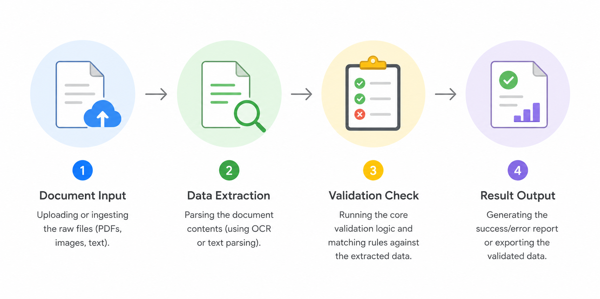
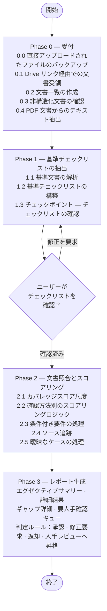

# document-validator

[](LICENSE)
[](https://github.com/googleapis/python-genai)
[](https://google.github.io/adk-docs/)
[](https://ai.google.dev/)

[English (en)](README.md) | [繁體中文 (zh-TW)](README.zh-TW.md) | [简体中文 (zh-CN)](README.zh-CN.md) | [日本語 (ja)](README.ja.md) | [한국어 (ko)](README.ko.md)

## 概要



`document-validator` は文書適合性検証エージェント（agent）です。**基準文書**（要件を定義する文書——法令、入札仕様書、審査委員会の意見、社内チェックリストなど）と**対象文書**（検証される文書——申請書、提案書、事業計画書など）を与えると、基準文書のすべての要件が対象文書で満たされているかを体系的に検証します。

このエージェントは単純なキーワード一致では動作しません。基準文書から構造化されたチェックリストを構築し、対象文書に対して各要件を評価し、何が満たされているか、何が部分的か、何が欠落しているかを明示した審査レポートを生成します——レビュアーが全ページを読まなくても即座に対応できるようにします。

---

## 設計思想とロジック



### Phase 0 — 受付
エージェントは提供されたすべての文書を一覧化し、レポート全体で追跡できるよう短い ID を割り当てます（例：基準文書は `C-1`、`C-2`、対象文書は `P-1`、`P-2`、`P-3`）。文書が非構造化または画像主体の場合、エージェントはその旨を通知し、ベストエフォートで抽出を続行します。

チャットに直接貼り付けるには大きすぎる文書は、代わりに Google Drive リンクで提供できます（例：「これが対象文書です：https://drive.google.com/file/d/.../view」）。エージェントは [`skills/document-validator/scripts/fetch_drive_file.py`](skills/document-validator/scripts/fetch_drive_file.py) を使って Google Drive API を直接呼び出します——チャットクライアントの connector を必要としないため、このスキルが別の環境（例：Google Agent Engine）にデプロイされたエージェントとして動作する場合でも機能します。認証には Application Default Credentials を使用し、Google ネイティブ文書（Docs/Sheets/Slides）はまず PDF にエクスポートしてすべての文書が同じページ引用規則に従うようにし、プレーンテキスト/Markdown ファイルは内容を直接読み込み、フォルダリンクは中の各ファイルを一覧の個別エントリに展開します。対象ファイルは、その認証情報が解決する ID（例：デプロイ先の service account）に共有されている必要があります——「リンクを知っている全員がアクセス可能」という公開共有は不要で、機密性の高い行政文書では通常使うべきではありません。

PDF 入力に対しては、エージェントは [`skills/document-validator/scripts/extract_pdf_text.py`](skills/document-validator/scripts/extract_pdf_text.py) を使って各ページを Markdown に変換します——引用のためにページ番号を保持し、表を雑然としたテキストではなく実際の Markdown 表として表現し、スキャン/画像主体と思われるページにフラグを立てます。検出された画像は記録されますが内容は抽出されないため、レビュアーは元の PDF で図表を確認する必要があることがわかります。処理に時間がかかりすぎるページ（大きな埋め込み画像）はタイムアウトし、要人手確認としてフラグが立てられます。ベクター図形が密集しているページ（CAD/3D 図面）の扱いは異なります——ページ上のテキスト（見出し、図説、注記）は通常どおり抽出され、図面そのものの視覚的内容だけがスキップされます。これはいずれにせよ人間が元のページを確認する必要があるためです。大きな PDF は一度にまとめて読み込むのではなくページ範囲ごとのチャンクで取得されるため、100 ページを超える基準文書も一度に全部読み込む必要はありません。

### Phase 1 — 基準チェックリストの抽出
エージェントは基準文書を解析し、すべての要件を抽出して以下のように分類します：

| 種類 | 説明 |
|------|------|
| **失格要件 (Disqualifying)** | いずれか一つでも満たされない場合は即座に返却 |
| **必須要件 (Mandatory)** | 無条件に存在し、満たされていなければならない |
| **条件付き要件 (Conditional)** | 特定の発生条件が当てはまる場合にのみ必須 |
| **推奨要件 (Advisory)** | 推奨だが必須ではない；記録のみでスコアリングしない |

基準文書が多層構造（章 → 条 → 項）を持つ場合、各要件の ID はドット表記でその階層を反映します——`REQ-1`、`REQ-1.2`、`REQ-1.2.3`——ID だけで基準文書内の位置がわかり、別途確認する必要がありません。

次のステップに進む前にチェックポイントが提示されます——ユーザーはチェックリストを確認するか、欠落している要件を追加するよう依頼できます。ユーザーが変更を依頼した場合、エージェントはまず何を変更したかを説明し、更新後の完全なチェックリストを再提示して確認を求めてから次に進みます。

### Phase 2 — 文書照合とスコアリング
各要件は適切な確認方法（フィールドの有無、キーワード一致、数値/形式の適合性、論理的整合性）を用いて対象文書全体に対してスコアリングされます。曖昧なケースでは、エージェントは関連する文章を引用し、自身の解釈を明示し、必要に応じてその項目を要人手確認としてフラグします。

カバレッジスコア：

| スコア | ラベル | 意味 |
|------|------|------|
| 90–100% | ✅ 適合 | 明確に対応済み；内容が完全 |
| 70–89% | ⚠️ 部分適合 | 記載はあるが不完全または曖昧 |
| 40–69% | ❌ 弱い | 間接的にしか関連しない、または明らかに不十分 |
| 0–39% | 🚫 欠落 | 対応する内容が見つからない |
| — | 🔍 判定不能 | 利用可能な唯一の証拠が、実際には読み取られなかった内容——画像、スキャン/空白ページ、図面そのものの視覚的内容（隣にあるテキストではない）、またはタイムアウトしたページ——である |

ページが画像、スキャン、または読み取れない状態であることは、その内容が適合していることの証拠にはなりません——それは「証拠の不存在」であり、「証拠の存在」ではありません。エージェントは、誰も実際に読んでいない内容に基づいて「適合」（または他のスコア付きラベル）と判定することは絶対にありません；このような場合は常に「判定不能」と評価し、要人手確認キューに送り、レビュアーが何を確認すべきかを明示します（例：「9 ページ目——図面、内容未抽出；必要な敷地配置図が含まれているか確認してください」）。このようにページを引用するには文章上の根拠が必要です——図説や相互参照（未解析の図面と一緒に抽出されることが多い）がそのページを当該要件と結び付けている場合に限られます；根拠がなければ、見つからない要件は単に「欠落」のままとし、無関係な図面ページを「関係あるかもしれない」という理由だけで引き込むべきではありません。スコアと「要人手確認フラグ」が矛盾することは絶対にありません——フラグが立てられている場合、スコアは必ず「判定不能」であり、自信に満ちたように見えるパーセンテージにはなりません。

### Phase 3 — レポート生成
エージェントは現在の会話で使用されている言語で構造化されたレポートを生成します（分析対象の文書自体の言語とは必ずしも一致しません）。内容は以下の通りです：

- **エグゼクティブサマリー** — 全体の適合率と判定の推奨
- **詳細結果表** — 要件ごとに 1 行、スコア・出典・備考を含む
- **ギャップ詳細** — 90% 未満のすべての項目に加え、すべての「判定不能」項目をカバーし、根本原因ごとにまとめて修正案を付記
- **要人手確認キュー** — 結論を出す前に人間の判断が必要な項目。誰も実際に読んでいない内容のみで支えられている項目も含む

判定オプション：*承認* / *修正要求* / *返却* / *人手レビューへ昇格*

---

## 使い方

### Antigravity での使い方とシナリオ

Antigravity プラグインまたはスキルとしてインストールした場合、最小限の `/` スラッシュコマンドと `@` ファイルメンション、または自然言語プロンプトで `document-validator` を呼び出すことができます：

| シナリオ | 最小コマンド（`/` + `@`） | 自然言語プロンプト |
|---|---|---|
| **ローカル PDF 検証** | `/document-validator Criteria: @guidelines.pdf, Pending: @application.pdf` | `"@guidelines.pdf の基準に従って @application.pdf が適合しているか検証してください。"` |
| **Google Drive 検証** | `/document-validator Criteria: https://drive.google.com/file/d/.../view, Pending: https://drive.google.com/file/d/.../view` | `"Drive 上のこの提案書が当社の入札仕様書のすべての必須要件を満たしているか確認してください。"` |

**ステップ 1** — 何を検証したいかを説明し、文書を提供します——PDF は Google Drive リンク（または直接アップロード / ローカル `@` ファイル参照）、プレーンテキスト/Markdown はメッセージに直接貼り付けます。基準は法令である必要はありません；いくつかの例：

### シナリオ：補助金/助成金申請の審査

> このアプリケーションパッケージを検証してください：
>
> 基準文書：
> - subsidy-program-guidelines.pdf — https://drive.google.com/file/d/1AbCdEfGhIjKlMnOpQrStUvWxYz/view
> - application-format-requirements.md
>
> 対象文書：
> - application-form-main.pdf — https://drive.google.com/file/d/1QwErTyUiOpAsDfGhJkLzXcVbNm/view
> - attachment-1-financial-statement.pdf — https://drive.google.com/file/d/1ZxCvBnMqWeRtYuIoPaSdFgHjKl/view
> - attachment-2-project-proposal.pdf — https://drive.google.com/file/d/1MnBvCxZaQwErTyUiOpLkJhGfDs/view

### シナリオ：入札文書の審査

> このベンダーの提案書が当社の入札仕様書のすべての必須要件を満たしているか確認してください：
>
> 基準文書：
> - tender-notice.pdf — https://drive.google.com/file/d/1TenderSpecAbCdEfGhIjKlMnOp/view
>
> 対象文書：
> - vendor-proposal.pdf — https://drive.google.com/file/d/1VendorBidAbCdEfGhIjKlMnOp/view

### シナリオ：審査委員会の意見反映確認

> 審査委員会の意見と請負業者が明言した約束事項に対してこの事業計画書を確認してください——約束した内容がすべて計画書に明確に反映されていることを確認してください。
>
> https://drive.google.com/file/d/1AbCdEfGhIjKlMnOpQrStUvWxYz/view

いずれのシナリオでも、エージェントはまず文書を一覧化し、スコアリングを始める前に基準チェックリストをあなたと確認します（上記 Phase 1 のチェックポイントを参照）。

**ステップ 2** — 検証レポートを受け取ります。上記の補助金/助成金シナリオの例：

> **文書検証レポート**
>
> 対象文書：application-form-main.pdf（+2 件の添付）
> 基準：subsidy-program-guidelines.pdf（+1 件の補助文書）
> 審査日：2026-06-18
>
> **エグゼクティブサマリー**
>
> 全体適合率：72%
> - ✅ 適合：11 項目
> - ⚠️ 部分適合：3 項目
> - ❌ 弱い：1 項目
> - 🚫 欠落：3 項目
>
> 判定：修正要求
>
> **詳細結果 — 必須要件**
>
> | ID | 要件 | 結果 | スコア | 出典 | 備考 |
> |----|------|------|------|------|------|
> | REQ-1 | 申請者の本人確認済み | ✅ | 98% | [P-1] §1.1 | |
> | REQ-2 | 事業目的の記載あり | ✅ | 95% | [P-1] §2.3 | |
> | REQ-3.1.1 | 予算明細の提供 | ⚠️ | 74% | [P-3] p.4 | 支出区分が欠落 |
> | REQ-4.1 | 財務諸表添付済み | ✅ | 100% | [P-2] | |
> | REQ-4.2 | 宣誓書添付 | 🚫 | 0% | — | いずれの対象文書にも見つからない |
> | REQ-4.3 | 同意書添付 | 🚫 | 0% | — | いずれの対象文書にも見つからない |
>
> **詳細結果 — 条件付き要件**
>
> | ID | 要件 | 発生条件は該当？ | 結果 | スコア | 出典 | 備考 |
> |----|------|----------------|------|------|------|------|
> | REQ-5 | 環境影響評価書 | はい | ⚠️ | 78% | [P-3] §5 | 概要のみ；完全な評価書は未添付 |
> | REQ-6 | 共同申請者の委任状 | いいえ | ➖ 該当なし | — | — | |
>
> **ギャップ詳細**
>
> REQ-4.2、REQ-4.3：宣誓書と同意書がいずれの対象文書にも見つかりません
> - 欠落内容：両文書とも対象文書に存在しない
> - 基準の根拠：[C-1] 第 4 条 第 2、3 項
> - 不備の種類：修正可能
> - 修正案：両文書を添付して再提出
>
> REQ-3.1.1：事業計画書に必要な予算明細が含まれていません
> - 欠落内容：支出区分が記載されていない
> - 証拠の出典：[P-3] p.4（部分的）
> - 基準の根拠：[C-2] 付録 1
> - 不備の種類：修正可能
> - 修正案：[C-2] 付録 1 に従って項目別予算表を追加

---

## プロジェクト構成

```
document-validator/
├── plugin.json                     # Agent Plugins 1.0 マニフェスト（skills と rules の登録）
├── AGENTS.md                       # リポジトリレベルのエージェントルールとエンジニアリング標準
├── rules/
│   └── AGENTS.md                   # plugin.json 経由で配布されるクライアント実行不変条件（Invariants）
├── skills/                         # Agent Plugins 1.0 に準拠した単一の信頼できる情報源（SSOT）
│   └── document-validator/
│       ├── SKILL.md                # 各フェーズ、要件の種類、レポート形式、実行ガイドライン
│       └── scripts/
│           ├── extract_pdf_text.py       # PDF → Markdown 抽出（並列ワーカー + CAD 高速パス）
│           ├── fetch_drive_file.py       # Google Drive API での取得（service account / ADC）
│           ├── gcs_state.py              # 直接アップロードされたファイルやチェックポイント状態を GCS にバックアップ・復元
│           ├── job_store.py              # 非同期ジョブの GCS 状態記録およびアトミックな 1 回配信（atomic deliver-once）
│           └── run_async_validation.py   # デタッチ型バックグラウンド基準抽出＆チェックリスト構築（デフォルト gemini-3.8-flash）
├── gemini-enterprise/              # 独立した Gemini Enterprise クラウドエージェントパッケージ
│   ├── agent/                      # ADK wrapper — skill/SKILL.md をシステムプロンプトとして読み込む
│   │   ├── __init__.py             # ADK ローダー用に root_agent をエクスポート
│   │   ├── agent.py                # LlmAgent の構築（デフォルトは gemini-3.8-flash）
│   │   ├── drive_tool.py           # fetch_drive_file_oauth — ユーザー個人の OAuth による Drive アクセス（デプロイ環境専用）
│   │   ├── recall.py               # before_agent_callback 経由で完了したバックグラウンドジョブの結果返却や中断ジョブの再開を実行
│   │   ├── skill_loader.py         # SKILL.md フロントマターのパーサー
│   │   └── tools.py                # start_job、check_job、read_asset、および start_async_validation
│   ├── skill/                      # skills/document-validator/ の下流ミラー（check_core_sync.py で検証）
│   ├── tests/
│   │   └── eval/                   # `agents-cli eval` 用の振る舞いレベル評価
│   │       ├── datasets/basic-dataset.json
│   │       └── eval_config.yaml
│   ├── agents-cli-manifest.yaml    # `agents-cli eval` および `agents-cli publish` 用のマニフェスト
│   ├── deployment_metadata.json    # deploy.sh により自動更新、`agents-cli publish gemini-enterprise` で使用
│   ├── deploy.sh                   # ルート ./deploy.sh に転送するラッパースクリプト
│   ├── GEMINI.md                   # Gemini Enterprise パッケージ開発・評価ガイド
│   ├── requirements.txt            # デプロイされるコンテナにインストールされるランタイム依存関係
│   ├── pyproject.toml              # Gemini Enterprise パッケージ設定
│   ├── .env.example                # クラウド環境変数テンプレート
│   └── .gitignore                  # パッケージレベルの Git 無視ルール
├── tests/                          # 単体テストおよび SSOT 同期検証
│   ├── check_core_sync.py          # skills/document-validator/ と gemini-enterprise/skill/ の完全一致を検証
│   └── test_*.py                   # Wrapper およびスクリプトの単体テスト
├── setup.sh                        # GCP インフラ、GCS バケット、IAM 権限の自動プロビジョニングスクリプト
├── deploy.sh                       # Vertex AI Agent Engine へのデプロイと Gemini Enterprise への登録
├── .env.example                    # setup.sh / deploy.sh 実行前に .env にコピーして使用
└── pyproject.toml                  # ローカル開発依存関係と pytest 設定
```

このリポジトリは **[Agent Plugins 1.0 Specification](https://agent-plugins.org/specification)** に準拠したデュアルターゲット構成になっています：
1. **Google Antigravity プラグイン＆スキル（`skills/document-validator/`）**：ローカル CLI / IDE エージェント実行のための単一の信頼できる情報源（SSOT）として機能します。
2. **Gemini Enterprise クラウドエージェント（`gemini-enterprise/`）**：ADK wrapper（[`gemini-enterprise/agent/`](gemini-enterprise/agent/)）と同期されたスキルミラー（[`gemini-enterprise/skill/`](gemini-enterprise/skill/)）を分離してパッケージ化しています。`agent/` wrapper は [`SKILL.md`](skills/document-validator/SKILL.md) をエージェントのシステムプロンプトに変換し、その `scripts/` を `start_job`/`check_job` 経由で呼び出し可能なツールとして公開します。`agent/` 内のものは文書検証に固有のものではありません——エージェントの動作を変更するには `skills/document-validator/SKILL.md` を編集すべきであり、wrapper のコードではありません。唯一の例外は [`drive_tool.py`](gemini-enterprise/agent/drive_tool.py) です：これは OAuth 同意フローを動かすために ADK の `ToolContext` を必要とし、`GOOGLE_OAUTH_CLIENT_ID` が設定されている場合にのみ登録されます；そうでない場合、エージェントは `fetch_drive_file.py` にフォールバックします。

## 評価とテスト

### 単体テストと SSOT 同期チェック

```bash
python3 tests/check_core_sync.py
pytest -v
```

### 振る舞いレベルの評価（`agents-cli eval`）

`tests/test_*.py` は wrapper とスクリプトの機構（`start_job` の実行、パストラバーサル拒否、PDF 抽出、非同期スコアリング）を検査します。コンプライアンス/ギャップ分析のロジック自体が「正しい」かどうか——正しい判定、正しく特定されたギャップ——は、`gemini-enterprise/` 内の [`google-agents-cli`](https://pypi.org/project/google-agents-cli/) 評価ツールで検証されます：

```bash
cd gemini-enterprise
agents-cli eval generate   # tests/eval/datasets/basic-dataset.json に対して実際のエージェントを実行
agents-cli eval grade      # tests/eval/eval_config.yaml のメトリクスに基づいてこれらのトレースを採点
```

`gcloud auth application-default login` と `GOOGLE_CLOUD_PROJECT`（`--project` で上書き可能）が必要です——これは実際の Gemini モデル（`gemini-3.8-flash`）を呼び出します。最初から用意されている 3 つのケースは、承認、必須要件の欠落、失格条件のケースをそれぞれカバーします；スキルが成長するにつれて `gemini-enterprise/tests/eval/datasets/` の下に追加してください。データセットのスキーマ、メトリクスの作成方法、失敗ケースに基づく反復のワークフローについては、`agents-cli eval --help` と `google-agents-cli-eval` スキルを参照してください。

---

## インストールとデプロイ

実行環境に応じて、以下の 2 つのデプロイ方法のいずれかを選択してください：

| デプロイ方法 | 対象環境 | セットアップツール | 主なインターフェース |
| :--- | :--- | :--- | :--- |
| **方法 1：Google Antigravity & Agent Plugins** | ローカル Antigravity IDE および Agent Skill | `pip` / `uv` + `./setup.sh` | Antigravity IDE チャット |
| **方法 2：Gemini Enterprise** | Cloud Vertex AI Agent Runtime | `./setup.sh` + `./deploy.sh` | Gemini Enterprise Web UI、Agent Engine |

### 方法 1：Google Antigravity プラグイン＆スキルインストール

**Agent Plugins 1.0** プラグインとしてインストールすると、エージェントが自動的に `skills/document-validator/` と `rules/AGENTS.md` の両方を読み込みます：

```bash
# オプション A：グローバルプラグインインストール（すべてのワークスペースで利用可能）
mkdir -p ~/.gemini/config/plugins
git clone https://github.com/sylphlin/document-validator.git ~/.gemini/config/plugins/document-validator

# オプション B：ワークスペースプラグインインストール（現在のプロジェクトのみ）
mkdir -p .agents/plugins
git clone https://github.com/sylphlin/document-validator.git .agents/plugins/document-validator

# オプション C：旧式の単一スキルディレクトリインストール（~/.gemini/config/skills/ 互換）
mkdir -p ~/.gemini/config/skills
ln -s ~/.gemini/config/plugins/document-validator/skills/document-validator ~/.gemini/config/skills/document-validator
```

ローカルの Python 依存関係をインストールし、Google Cloud 環境を初期化します（Google Drive 取得や非同期検証を使用する場合）：

```bash
cd ~/.gemini/config/plugins/document-validator
pip install -e ".[dev]"
./setup.sh --project <your-project-id>
```

### 方法 2：Gemini Enterprise クラウドデプロイ

#### 1. クラウドインフラの自動構築（`setup.sh`）

`setup.sh` を実行すると、必要な GCP API の有効化、セッションバケット（`gs://document-validator-sessions-${PROJECT_ID}`、15 日間のライフサイクル自動削除付き）およびステージングバケット（`gs://document-validator-staging-${PROJECT_ID}`）の作成と設定、Service Account IAM 権限の付与、`.env` への設定書き込みが自動的に行われます：

```bash
./setup.sh -p <your-project-id> -r us-central1
# 変更を加えずに実行内容をプレビュー：
./setup.sh --dry-run -p <your-project-id>
```

必要に応じて `.env` を編集します — 基準文書や対象文書の PDF が非常に大きい場合は `AGENT_MEMORY`（デフォルト `32Gi`）を調整してください。メモリが不足するとコンテナはエラーログを残さず OOM-killed されます。

#### 2. Vertex AI Agent Engine へのデプロイと Gemini Enterprise への登録（`deploy.sh`）

```bash
# Vertex AI Agent Engine へデプロイ
./deploy.sh

# デプロイと同時に agents-cli publish 経由で Gemini Enterprise に自動登録
./deploy.sh --project <your-project-id> --region us-central1 --ge <your-ge-app-id>

# または位置引数で project/region を上書き：
./deploy.sh <project-id> <region>
```

`deploy.sh` は `gemini-enterprise/agent` と `gemini-enterprise/skill` をまとめてステージングし、`adk deploy agent_engine` でデプロイし、`AGENT_ENGINE_ID` を `.env` に保存し、`gemini-enterprise/deployment_metadata.json` を書き出します。初回実行後の再デプロイでは、既存の Agent Engine インスタンスがそのまま更新されます。

#### 3. Google Drive アクセスとセッション永続化に関する注意事項

- **Service Account による Drive アクセス（デフォルト）：** デフォルトの Google Drive 取得経路（`fetch_drive_file.py`）では、デプロイされた service account がレビュアーのリンク先ファイルにアクセス権を持っている必要があります。対象ファイル・フォルダを service account のメールアドレスに共有してください；「リンクを知っている全員」への公開共有は不要です。
- **ユーザー個人の OAuth による Drive アクセス（オプション）：** `.env` で `GOOGLE_OAUTH_CLIENT_ID` と `GOOGLE_OAUTH_CLIENT_SECRET`（`.env.example` 参照）を設定すると [`gemini-enterprise/agent/drive_tool.py`](gemini-enterprise/agent/drive_tool.py) が有効になり、Gemini Enterprise にサインインしているユーザーとして Drive にアクセスします。Google Cloud Console → APIs & Services → Credentials で OAuth クライアント（種類は「ウェブ アプリケーション」、Drive API を有効化、同意画面のスコープは `drive.readonly`）を作成してください。両方空のままにすると service account 経路が使用されます。
- **一時コンテナの状態バックアップとバックグラウンドジョブの復元（`gcs_state.py`、`job_store.py`、`recall.py`）：** Agent Engine のコンテナインスタンスは一時的であり、同じ会話のターン間で入れ替わることがあります。`gcs_state.py` は直接アップロードされたファイルとチェックポイント状態を `gs://document-validator-sessions-{GOOGLE_CLOUD_PROJECT}`（`./setup.sh` が自動作成）にバックアップ・復元し、`job_store.py` と `recall.py` はデタッチ型バックグラウンド基準抽出ジョブ（`run_async_validation.py`）を追跡して、次のターンで完了したチェックリストの自動配信や中断ジョブの再開を行います。
