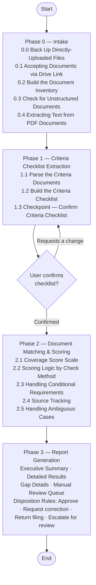

# document-validator

[](LICENSE)
[](https://github.com/googleapis/python-genai)
[](https://google.github.io/adk-docs/)
[](https://ai.google.dev/)

[English (en)](README.md) | [繁體中文 (zh-TW)](README.zh-TW.md) | [简体中文 (zh-CN)](README.zh-CN.md) | [日本語 (ja)](README.ja.md) | [한국어 (ko)](README.ko.md)

## Overview


`document-validator` is a document conformance agent. Given **Criteria Documents** (what defines the requirements — a regulation, a tender specification, review-committee comments, an internal checklist) and **Pending Documents** (the document(s) being checked against it — an application, a bid, a project plan), it systematically checks whether every requirement in the criteria is addressed in the pending documents.

The agent does not simply scan for keywords. It builds a structured criteria checklist from the criteria, scores each requirement against the pending documents, and produces an audit report that clearly shows what is present, what is partial, and what is missing — so a reviewer can act immediately without reading every page themselves.

---

## Design Philosophy & Logic



### Phase 0 — Intake
The agent inventories all provided documents and assigns short IDs for traceability throughout the report (e.g. `C-1`, `C-2` for the criteria documents; `P-1`, `P-2`, `P-3` for the pending documents). If any document is unstructured or image-based, the agent announces this and proceeds with best-effort extraction.

Documents that are too large to paste into chat can be provided as a Google Drive link instead (e.g. "Here is the pending document: https://drive.google.com/file/d/.../view"). The agent fetches the file using [`skills/document-validator/scripts/fetch_drive_file.py`](skills/document-validator/scripts/fetch_drive_file.py), which calls the Google Drive API directly — no chat-client connector required, so this also works when the skill runs as an agent deployed elsewhere (e.g. Google Agent Engine). It authenticates with Application Default Credentials, exports Google-native documents (Docs/Sheets/Slides) to PDF first so every document follows the same page-citation convention, reads plain-text/Markdown files directly into context, and expands folder links into one inventory entry per file inside. The target file must be shared with whatever identity those credentials resolve to (the deployed service account, for example) — a public "anyone with the link" share is not required and, for sensitive government filings, usually shouldn't be used.

For PDF inputs, the agent uses [`skills/document-validator/scripts/extract_pdf_text.py`](skills/document-validator/scripts/extract_pdf_text.py) to convert each page to Markdown — preserving page numbers for citation, rendering tables as real Markdown tables instead of jumbled text, and flagging pages that look scanned/image-based. Detected images are noted but not extracted, so a reviewer knows to check the original PDF for figures. A page that takes too long (a large embedded image) times out and is flagged for manual review. A page dense with vector graphics (a CAD/3D drawing) is handled differently: any text on it — titles, captions, notes — is still extracted normally; only the drawing's own visual content is skipped, since that needs a human to look at the rendered page either way. Large PDFs are pulled in page-range chunks instead of one large dump, so a 100+ page criteria document doesn't need to be loaded all at once.

### Phase 1 — Criteria Checklist Extraction
The agent parses the criteria documents and extracts every requirement, classifying each one by type:

| Type | Description |
|------|-------------|
| **Disqualifying** | Any failure triggers immediate return of the filing |
| **Mandatory** | Must be present and met unconditionally |
| **Conditional** | Required only when a specified trigger condition applies |
| **Advisory** | Recommended but not required; noted without scoring |

When the criteria have a multi-level structure (chapter → article → item), each requirement's ID mirrors that nesting with dot notation — `REQ-1`, `REQ-1.2`, `REQ-1.2.3` — so the ID alone shows where it sits in the criteria, without a separate lookup.

A checkpoint is presented before proceeding — the user can confirm the checklist or add missing requirements. If the user requests a change, the agent describes what changed and re-presents the full updated checklist for confirmation before moving on.

### Phase 2 — Document Matching & Scoring
Each requirement is scored against the full pending documents using the appropriate check method (field presence, keyword match, numeric/format compliance, or logical consistency). For ambiguous cases, the agent quotes the relevant passage, states its interpretation, and flags the item for manual review if needed.

Coverage scores:

| Score | Label | Meaning |
|-------|-------|---------|
| 90–100% | ✅ Compliant | Clearly addressed; content is complete |
| 70–89% | ⚠️ Partial | Present but incomplete or vague |
| 40–69% | ❌ Weak | Only indirectly related or severely insufficient |
| 0–39% | 🚫 Missing | No corresponding content found |
| — | 🔍 Indeterminate | The only available evidence is content that was never actually read — an image, a scanned/blank page, a drawing's own visual content (not the text alongside it), or a page that timed out |

A page being image-based, scanned, or otherwise unreadable is not evidence of what it contains — it's the absence of evidence. The agent never assigns Compliant (or any of the other scored labels) based on content nobody actually read; it scores those items Indeterminate, routes them to the Manual Review queue, and states exactly what a human needs to check (e.g. "p.9 — diagram, not extracted; confirm it shows the required site layout"). Citing a page like that requires a textual basis — a caption or cross-reference, often extracted right alongside an otherwise-unanalyzed drawing, that connects that page to the specific requirement; without one, a missing requirement just stays Missing rather than pulling in unrelated drawing pages on the chance one might be relevant. A Score and a "flag for manual review" can never disagree — if it's flagged, the score is Indeterminate, not a confident-looking percentage.

### Phase 3 — Report Generation
The agent produces a structured report in the language the user is communicating in (not necessarily the language of the input documents being analyzed), containing:

- **Executive summary** — overall compliance rate and disposition recommendation
- **Detailed results table** — one row per requirement, with score, source reference, and notes
- **Gap details** — for every item below 90% plus every Indeterminate item, consolidated by root cause with correction suggestions
- **Manual review queue** — items that require human judgment before a verdict can be issued, including any item only supported by content nobody actually read

Disposition options: *Approve* / *Request correction* / *Return filing* / *Escalate for review*

---

## How to Use

### Antigravity Usage & Scenarios

When installed as an Antigravity plugin or skill, you can invoke `document-validator` with minimal `/` slash commands + `@` file mentions, or natural language prompts:

| Scenario | Minimal Command (`/` + `@`) | Natural Language Prompt |
|---|---|---|
| **Local PDF Validation** | `/document-validator Criteria: @guidelines.pdf, Pending: @application.pdf` | `"Please validate @application.pdf against the criteria in @guidelines.pdf."` |
| **Google Drive Validation** | `/document-validator Criteria: https://drive.google.com/file/d/.../view, Pending: https://drive.google.com/file/d/.../view` | `"Check whether this pending proposal on Drive meets all mandatory requirements in our tender spec."` |

**Step 1** — Describe what you're validating and provide the documents — PDFs
as a Google Drive link (or a direct upload / local `@` file reference), plain text/Markdown pasted right
into the message. The criteria don't have to be a regulation; a few example
scenarios:

### Scenario: Grant/Subsidy Application Review

> Please validate this application package:
>
> Criteria Documents:
> - subsidy-program-guidelines.pdf — https://drive.google.com/file/d/1AbCdEfGhIjKlMnOpQrStUvWxYz/view
> - application-format-requirements.md
>
> Pending Documents:
> - application-form-main.pdf — https://drive.google.com/file/d/1QwErTyUiOpAsDfGhJkLzXcVbNm/view
> - attachment-1-financial-statement.pdf — https://drive.google.com/file/d/1ZxCvBnMqWeRtYuIoPaSdFgHjKl/view
> - attachment-2-project-proposal.pdf — https://drive.google.com/file/d/1MnBvCxZaQwErTyUiOpLkJhGfDs/view

### Scenario: Tender Document Review

> Check whether this vendor's bid meets every mandatory requirement in our tender spec:
>
> Criteria Documents:
> - tender-notice.pdf — https://drive.google.com/file/d/1TenderSpecAbCdEfGhIjKlMnOp/view
>
> Pending Documents:
> - vendor-proposal.pdf — https://drive.google.com/file/d/1VendorBidAbCdEfGhIjKlMnOp/view

### Scenario: Committee Feedback Review

> Check this project proposal against the review committee's comments and the
> contractor's stated commitments — make sure everything they committed to is
> clearly reflected in the proposal.
>
> https://drive.google.com/file/d/1AbCdEfGhIjKlMnOpQrStUvWxYz/view

In every scenario, the agent inventories the documents and confirms a Criteria
Checklist with you before scoring (see Phase 1's checkpoint above).

**Step 2** — Receive the validation report, e.g. for the Grant/Subsidy scenario above:

> **Document Validation Report**
>
> Pending document(s): application-form-main.pdf (+2 attachments)
> Criteria: subsidy-program-guidelines.pdf (+1 supporting doc)
> Review date: 2026-06-18
>
> **Executive Summary**
>
> Overall compliance rate: 72%
> - ✅ Compliant: 11 items
> - ⚠️ Partial: 3 items
> - ❌ Weak: 1 item
> - 🚫 Missing: 3 items
>
> Disposition: Request correction
>
> **Detailed Results — Mandatory Requirements**
>
> | ID | Requirement | Result | Score | Source | Notes |
> |----|-------------|--------|-------|--------|-------|
> | REQ-1 | Applicant identity verified | ✅ | 98% | [P-1] §1.1 | |
> | REQ-2 | Project objectives stated | ✅ | 95% | [P-1] §2.3 | |
> | REQ-3.1.1 | Budget breakdown provided | ⚠️ | 74% | [P-3] p.4 | Expenditure categories missing |
> | REQ-4.1 | Financial statement attached | ✅ | 100% | [P-2] | |
> | REQ-4.2 | Declaration letter attached | 🚫 | 0% | — | Not found in any pending document |
> | REQ-4.3 | Consent form attached | 🚫 | 0% | — | Not found in any pending document |
>
> **Detailed Results — Conditional Requirements**
>
> | ID | Requirement | Trigger applies? | Result | Score | Source | Notes |
> |----|-------------|-----------------|--------|-------|--------|-------|
> | REQ-5 | Environmental impact statement | Yes | ⚠️ | 78% | [P-3] §5 | Summary only; full assessment not attached |
> | REQ-6 | Co-applicant authorization letter | No | ➖ N/A | — | — | |
>
> **Gap Details**
>
> REQ-4.2, REQ-4.3: Declaration letter and consent form not found in any pending document
> - What is missing: Both documents are absent from the pending documents
> - Criteria reference: [C-1] Article 4, Items 2–3
> - Deficiency type: Correctable
> - Suggested correction: Attach both documents and resubmit
>
> REQ-3.1.1: Project proposal does not include required budget breakdown
> - What is missing: Expenditure categories not listed
> - Evidence found in: [P-3] p.4 (partial)
> - Criteria reference: [C-2] Appendix 1
> - Deficiency type: Correctable
> - Suggested correction: Add a line-item budget table per [C-2] Appendix 1

---

## Project Structure

```
document-validator/
├── plugin.json                     # Agent Plugins 1.0 manifest (skills & rules registration)
├── AGENTS.md                       # Repository-level agent rules & engineering standards
├── rules/
│   └── AGENTS.md                   # Client execution invariants distributed via plugin.json
├── skills/                         # Canonical Single Source of Truth (SSOT) for Agent Plugins 1.0
│   └── document-validator/
│       ├── SKILL.md                # Phases, requirement types, report format, execution guidelines
│       └── scripts/
│           ├── extract_pdf_text.py       # PDF → Markdown extraction
│           ├── fetch_drive_file.py       # Google Drive API fetch (service account / ADC)
│           ├── gcs_state.py              # Backs up files/state with no other durable source to GCS
│           └── run_async_validation.py   # Map-Reduce batch conformance scoring (gemini-3.8-flash)
├── gemini-enterprise/              # Isolated Gemini Enterprise Cloud Agent Package
│   ├── agent/                      # ADK wrapper — loads skill/SKILL.md as the system prompt
│   │   ├── __init__.py             # Exports root_agent for the ADK loader
│   │   ├── agent.py                # LlmAgent construction (defaults to gemini-3.8-flash)
│   │   ├── drive_tool.py           # fetch_drive_file_oauth — per-user OAuth Drive access (deployed only)
│   │   ├── recall.py               # Automatic GCS session restoration after container swap
│   │   ├── skill_loader.py         # SKILL.md frontmatter parser
│   │   └── tools.py                # start_job/check_job (background script execution) and read_asset
│   ├── skill/                      # Downstream mirror of skills/document-validator/ (verified by check_core_sync.py)
│   ├── tests/
│   │   └── eval/                   # Behavior-level eval for `agents-cli eval`
│   │       ├── datasets/basic-dataset.json
│   │       └── eval_config.yaml
│   ├── agents-cli-manifest.yaml    # Manifest for `agents-cli eval` and `agents-cli publish`
│   ├── deployment_metadata.json    # Auto-updated by deploy.sh for `agents-cli publish gemini-enterprise`
│   ├── deploy.sh                   # Convenience wrapper forwarding to root ./deploy.sh
│   ├── requirements.txt            # Runtime dependencies installed into the deployed container
│   ├── pyproject.toml              # Gemini Enterprise package metadata
│   └── .env.example                # Cloud environment template
├── tests/                          # Unit tests & SSOT synchronization guard
│   ├── check_core_sync.py          # Verifies skills/document-validator/ == gemini-enterprise/skill/
│   └── test_*.py                   # Wrapper & script unit tests
├── setup.sh                        # Automated GCP infrastructure, GCS buckets, & IAM setup
├── deploy.sh                       # Deploys to Vertex AI Agent Engine & registers with Gemini Enterprise
├── .env.example                    # Copy to .env and fill in before running setup.sh / deploy.sh
└── pyproject.toml                  # Local dev dependencies and pytest configuration
```

This repository is structured as a dual-target package compliant with the **[Agent Plugins 1.0 Specification](https://agent-plugins.org/specification)**:
1. **Google Antigravity Plugin & Skill (`skills/document-validator/`)**: Serves as the canonical Single Source of Truth (SSOT) for local CLI/IDE agent execution.
2. **Gemini Enterprise Cloud Agent (`gemini-enterprise/`)**: Isolates the ADK wrapper ([`gemini-enterprise/agent/`](gemini-enterprise/agent/)) and a synchronized mirror of the skill ([`gemini-enterprise/skill/`](gemini-enterprise/skill/)). The `agent/` wrapper turns [`SKILL.md`](skills/document-validator/SKILL.md) into the agent's system prompt and exposes its `scripts/` via `start_job`/`check_job`. Nothing in `agent/` is specific to document validation — changing the agent's behavior means editing `skills/document-validator/SKILL.md`, not the wrapper code. The one exception is [`drive_tool.py`](gemini-enterprise/agent/drive_tool.py): it needs ADK's `ToolContext` to drive an OAuth consent flow, which only exists for a proper ADK FunctionTool. It is registered only when `GOOGLE_OAUTH_CLIENT_ID` is configured; otherwise the agent falls back to `fetch_drive_file.py`.

## Evaluation & Testing

### Unit Tests & SSOT Sync Check

```bash
python3 tests/check_core_sync.py
pytest -v
```

### Behavior-Level Evaluation (`agents-cli eval`)

`tests/test_*.py` checks wrapper and script mechanics (`start_job` execution, path traversal rejection, PDF extraction, async scoring). Whether the compliance/gap-analysis logic itself is *correct* — right disposition, right gap identified — is validated via [`google-agents-cli`](https://pypi.org/project/google-agents-cli/)'s eval tooling inside `gemini-enterprise/`:

```bash
cd gemini-enterprise
agents-cli eval generate   # runs the real agent over tests/eval/datasets/basic-dataset.json
agents-cli eval grade      # scores the traces against tests/eval/eval_config.yaml's metrics
```

Requires `gcloud auth application-default login` and a `GOOGLE_CLOUD_PROJECT` (pass `--project` to override) — this calls the real Gemini model (`gemini-3.8-flash`). The three seeded cases cover an approve, a missing-mandatory-requirement, and a disqualifying-condition case; add more under `gemini-enterprise/tests/eval/datasets/` as the skill grows. See `agents-cli eval --help` and the `google-agents-cli-eval` skill for the dataset schema, metric authoring, and the iterate-on-failures workflow.

---

## Installation & Deployment

Select one of the two deployment methods below based on your target environment:

| Method | Target Environment | Setup Tool | Primary Interface |
| :--- | :--- | :--- | :--- |
| **Method 1: Google Antigravity & Agent Plugins** | Local Antigravity IDE and Agent Skill | `pip` / `uv` + `./setup.sh` | Antigravity IDE chat |
| **Method 2: Gemini Enterprise** | Cloud Vertex AI Agent Runtime | `./setup.sh` + `./deploy.sh` | Gemini Enterprise Web UI, Agent Engine |

### Method 1: Google Antigravity Plugin & Skill Installation

Install as an **Agent Plugins 1.0** plugin so your agent automatically loads both `skills/document-validator/` and `rules/AGENTS.md`:

```bash
# Option A: Global Plugin Installation (Available across all workspaces)
mkdir -p ~/.gemini/config/plugins
git clone https://github.com/sylphlin/document-validator.git ~/.gemini/config/plugins/document-validator

# Option B: Workspace Plugin Installation (Scoped to current project)
mkdir -p .agents/plugins
git clone https://github.com/sylphlin/document-validator.git .agents/plugins/document-validator

# Option C: Legacy Single-Skill Symlink (~/.gemini/config/skills/ compatibility)
mkdir -p ~/.gemini/config/skills
ln -s ~/.gemini/config/plugins/document-validator/skills/document-validator ~/.gemini/config/skills/document-validator
```

Install local Python dependencies and initialize the Google Cloud environment (optional if using Google Drive fetch or async validation):

```bash
cd ~/.gemini/config/plugins/document-validator
pip install -e ".[dev]"
./setup.sh --project <your-project-id>
```

### Method 2: Gemini Enterprise Cloud Deployment

#### 1. Cloud Infrastructure Provisioning (`setup.sh`)

Run `setup.sh` to automatically enable required GCP APIs, create and configure the session bucket (`gs://document-validator-sessions-${PROJECT_ID}` with 15-day lifecycle auto-cleanup) and staging bucket (`gs://document-validator-staging-${PROJECT_ID}`), bind Service Account IAM permissions, and write configuration to `.env`:

```bash
./setup.sh -p <your-project-id> -r us-central1
# Preview actions without making changes:
./setup.sh --dry-run -p <your-project-id>
```

Edit `.env` if needed — bump `AGENT_MEMORY` (default `8Gi`) if criteria or pending-document PDFs run large, as the container is silently OOM-killed if it runs out of memory.

#### 2. Deploy to Vertex AI Agent Engine & Register with Gemini Enterprise (`deploy.sh`)

```bash
# Deploy to Vertex AI Agent Engine
./deploy.sh

# Deploy and automatically register with Gemini Enterprise via agents-cli publish
./deploy.sh --project <your-project-id> --region us-central1 --ge <your-ge-app-id>

# Or use positional arguments:
./deploy.sh <project-id> <region>
```

`deploy.sh` stages `gemini-enterprise/agent` and `gemini-enterprise/skill` together, deploys via `adk deploy agent_engine`, saves the `AGENT_ENGINE_ID` to `.env`, and writes `gemini-enterprise/deployment_metadata.json`. Redeploying after the first run updates the existing Agent Engine instance in-place.

#### 3. Google Drive Access & Session Persistence Notes

- **Service Account Drive Access (Default):** The default Google Drive fetch path (`fetch_drive_file.py`) requires the deployed service account to have access to the files reviewers link to. Share target Drive files/folders with the service account's email address; public "anyone with the link" sharing is not required.
- **Per-User OAuth Drive Access (Optional):** Set `GOOGLE_OAUTH_CLIENT_ID` and `GOOGLE_OAUTH_CLIENT_SECRET` in `.env` (see `.env.example`) to enable [`gemini-enterprise/agent/drive_tool.py`](gemini-enterprise/agent/drive_tool.py). When configured, the agent accesses Drive as whichever user is signed in through Gemini Enterprise. Create the OAuth client in Google Cloud Console → APIs & Services → Credentials (type "Web application", Drive API enabled, consent screen scoped to `drive.readonly`). Leave both blank to use the service-account path.
- **Ephemeral Container State (`gcs_state.py` & `recall.py`):** Agent Engine container instances are ephemeral and can be swapped between turns of the same conversation. `gcs_state.py` backs up uploaded files and extracted state to `gs://document-validator-sessions-{GOOGLE_CLOUD_PROJECT}` (created automatically by `./setup.sh`), and `recall.py` transparently restores them when a container swap occurs.
