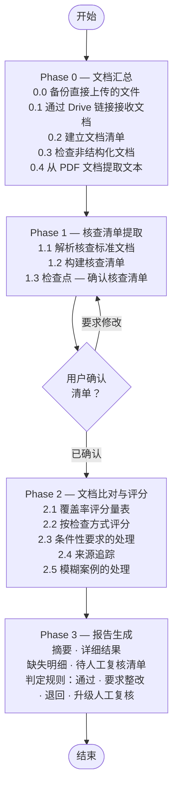

# document-validator

[](LICENSE)
[](https://github.com/googleapis/python-genai)
[](https://google.github.io/adk-docs/)
[](https://ai.google.dev/)

[English (en)](README.md) | [繁體中文 (zh-TW)](README.zh-TW.md) | [简体中文 (zh-CN)](README.zh-CN.md) | [日本語 (ja)](README.ja.md) | [한국어 (ko)](README.ko.md)

## 概览


`document-validator` 是一个文档合规核查代理（agent）。给定**核查标准文档**（定义要求的文档——可能是法规、招标规范、评审委员会意见、内部检查清单）与**待核查文档**（要被核查的文档——申请书、投标书、项目方案），它会系统地检查标准中的每一项要求是否在待核查文档中得到满足。

这个代理不只是做关键词匹配。它会从标准文档中构建结构化的核查清单，逐项对照待核查文档评分，并生成一份审核报告，清晰标示哪些条目已满足、哪些部分满足、哪些缺失——让审核人员无需逐页阅读就能立即采取行动。

---

## 设计理念与逻辑



### Phase 0 — 文档汇总
代理会清点所有提供的文档，并分配简短 ID 以便在报告中追踪（例如核查标准文档用 `C-1`、`C-2`；待核查文档用 `P-1`、`P-2`、`P-3`）。如果某个文档是非结构化或以图片为主，代理会主动告知，并尽力进行提取。

太大而无法直接粘贴到对话中的文档，可以改用 Google Drive 链接提供（例如"这是待核查文档：https://drive.google.com/file/d/.../view"）。代理会通过 [`skills/document-validator/scripts/fetch_drive_file.py`](skills/document-validator/scripts/fetch_drive_file.py) 直接调用 Google Drive API 获取文件——不需要聊天客户端的 connector，因此即使这个 skill 部署在其他环境（例如 Google Agent Engine）也能正常工作。它使用 Application Default Credentials 进行身份验证，会先把 Google 原生文档（Docs/Sheets/Slides）导出为 PDF，让所有文档遵循相同的页码引用规范；纯文本/Markdown 文件则直接读入内容；文件夹链接则展开为清单中每个文件各一条记录。目标文件必须分享给这组凭据所对应的身份（例如部署用的 service account）——不需要、通常也不应该对政府类文件采用"知道链接的任何人均可访问"的公开分享方式。

对于 PDF 输入，代理使用 [`skills/document-validator/scripts/extract_pdf_text.py`](skills/document-validator/scripts/extract_pdf_text.py) 将每一页转换为 Markdown——保留页码以便引用、将表格转换为真正的 Markdown 表格而非杂乱文本，并标记出疑似扫描/以图片为主的页面。检测到的图片会被记录但不会提取其内容，让审核人员知道需要回头查看原始 PDF 中的图表。耗时过长的页面（内嵌大图片）会超时并被标记为待人工审核。矢量图形密集的页面（CAD/3D 图）则不同：页面上的文字（标题、图说、注释）仍会正常提取，只有图形本身的视觉内容会被跳过，因为那本来就需要人工查看原始页面才能确认。大型 PDF 会按页码范围分块提取，而不是一次性读入，让超过 100 页的标准文档不需要一次性全部加载。

### Phase 1 — 核查清单提取
代理会解析核查标准文档并提取每一项要求，按类型分类：

| 类型 | 说明 |
|------|------|
| **取消资格 (Disqualifying)** | 任何一项不满足即立即退回 |
| **强制 (Mandatory)** | 必须无条件满足 |
| **条件性 (Conditional)** | 仅在特定触发条件成立时才需满足 |
| **建议性 (Advisory)** | 建议但非强制；仅记录不评分 |

当核查标准具有多层结构（章 → 条 → 项）时，每项要求的 ID 会用小数点表示这一层级——`REQ-1`、`REQ-1.2`、`REQ-1.2.3`——让人光看 ID 就能知道它在标准中的位置，不需要另外查找。

在进入下一步之前会有一个检查点——用户可以确认清单，或要求补充遗漏的要求。如果用户要求修改，代理会先说明改动了什么，再重新呈现完整的更新后清单供确认，确认后才会继续。

### Phase 2 — 文档比对与评分
每项要求会按适当的检查方式（字段是否存在、关键词匹配、数值/格式合规、逻辑一致性）对照完整的待核查文档进行评分。遇到模糊案例时，代理会引用相关段落、说明自己采用的解读方式，并在需要时将该条目标记为待人工复核。

覆盖率评分：

| 分数 | 标签 | 含义 |
|------|------|------|
| 90–100% | ✅ 符合 | 明确处理；内容完整 |
| 70–89% | ⚠️ 部分符合 | 有提及但不完整或含糊 |
| 40–69% | ❌ 薄弱 | 仅间接相关或明显不足 |
| 0–39% | 🚫 缺失 | 找不到对应内容 |
| — | 🔍 无法判定 | 唯一可用的证据是从未被实际读取的内容——图片、扫描/空白页、图纸本身的视觉内容（不是旁边的文字），或处理超时的页面 |

页面是图片、扫描或无法读取，并不代表其内容已被确认符合——这代表的是"缺乏证据"，而不是"证据存在"。代理绝不会基于没有人实际读过的内容判定为"符合"（或其他任何已评分的标签）；遇到这类情况一律评为"无法判定"，并送入待人工复核清单，明确指出审核人员需要确认什么（例如"第 9 页——图纸未提取内容；请确认其中是否包含所需的场地布局图"）。这样引用某一页需要有文字依据——图说或交叉引用（通常与未分析的图纸一起被提取出来），把那一页与这项具体要求联系起来；没有这个依据，找不到的要求就维持缺漏，不要因为文档里有不相关的图纸页就硬拉进来当理由。分数与"是否标记待人工复核"绝不会互相矛盾——一旦被标记，分数就是"无法判定"，不会是一个看起来很有把握的百分比。

### Phase 3 — 报告生成
代理会用用户当前对话所使用的语言生成结构化报告（不一定是被分析文档本身的语言），内容包括：

- **摘要** — 整体符合率与判定建议
- **详细结果表** — 每项要求各一行，含分数、来源出处与备注
- **缺失明细** — 涵盖所有低于 90% 的条目，再加上每一个"无法判定"条目，按根本原因归类并附整改建议
- **待人工复核清单** — 需要人工判断才能得出结论的条目，包括任何仅由"没有人实际读过的内容"支撑的条目

判定选项：*通过* / *要求整改* / *退回* / *升级人工复核*

---

## 如何使用

### Antigravity 使用方式与场景

当安装为 Antigravity 插件（Plugin）或技能（Skill）时，你可以使用极简的 `/` 斜杠命令配合 `@` 文件提及，或使用自然语言提示词调用 `document-validator`：

| 场景 | 极简命令（`/` + `@`） | 自然语言提示词 |
|---|---|---|
| **本地 PDF 核查** | `/document-validator Criteria: @guidelines.pdf, Pending: @application.pdf` | `"请依据 @guidelines.pdf 的核查标准，检查 @application.pdf 是否符合规定。"` |
| **Google Drive 核查** | `/document-validator Criteria: https://drive.google.com/file/d/.../view, Pending: https://drive.google.com/file/d/.../view` | `"请检查这份云端硬盘上的投标书是否满足我们招标规范中的每一项强制要求。"` |

**第一步** — 说明你要核查什么，并提供文档——PDF 可使用 Google Drive 链接（或直接上传 / 本地 `@` 文件引用），纯文本/Markdown 可以直接粘贴在消息中。核查标准不一定要是法规；以下是几个示例场景：

### 场景：补贴/资助申请审核

> 请核查这份申请文件包：
>
> 核查标准文档：
> - subsidy-program-guidelines.pdf — https://drive.google.com/file/d/1AbCdEfGhIjKlMnOpQrStUvWxYz/view
> - application-format-requirements.md
>
> 待核查文档：
> - application-form-main.pdf — https://drive.google.com/file/d/1QwErTyUiOpAsDfGhJkLzXcVbNm/view
> - attachment-1-financial-statement.pdf — https://drive.google.com/file/d/1ZxCvBnMqWeRtYuIoPaSdFgHjKl/view
> - attachment-2-project-proposal.pdf — https://drive.google.com/file/d/1MnBvCxZaQwErTyUiOpLkJhGfDs/view

### 场景：招标文件审核

> 请检查这家供应商的投标书是否满足我们招标规范中的每一项强制要求：
>
> 核查标准文档：
> - tender-notice.pdf — https://drive.google.com/file/d/1TenderSpecAbCdEfGhIjKlMnOp/view
>
> 待核查文档：
> - vendor-proposal.pdf — https://drive.google.com/file/d/1VendorBidAbCdEfGhIjKlMnOp/view

### 场景：评审委员会意见落实核查

> 请对照评审委员会的意见和供应商承诺的事项，检查这份项目方案——确保供应商承诺的每一项都明确落实在方案中。
>
> https://drive.google.com/file/d/1AbCdEfGhIjKlMnOpQrStUvWxYz/view

在每一种场景中，代理都会先清点文档，并在开始评分前与你确认核查清单（见上方 Phase 1 的检查点）。

**第二步** — 收到核查报告，以上方补贴/资助场景为例：

> **文档核查报告**
>
> 待核查文档：application-form-main.pdf（+2 份附件）
> 核查标准：subsidy-program-guidelines.pdf（+1 份配套文档）
> 审核日期：2026-06-18
>
> **摘要**
>
> 整体符合率：72%
> - ✅ 符合：11 项
> - ⚠️ 部分符合：3 项
> - ❌ 薄弱：1 项
> - 🚫 缺失：3 项
>
> 判定：要求整改
>
> **详细结果 — 强制要求**
>
> | ID | 要求 | 结果 | 分数 | 来源 | 备注 |
> |----|------|------|------|------|------|
> | REQ-1 | 申请人身份已验证 | ✅ | 98% | [P-1] §1.1 | |
> | REQ-2 | 已陈述项目目标 | ✅ | 95% | [P-1] §2.3 | |
> | REQ-3.1.1 | 提供预算明细 | ⚠️ | 74% | [P-3] p.4 | 缺少支出类别 |
> | REQ-4.1 | 已附财务报表 | ✅ | 100% | [P-2] | |
> | REQ-4.2 | 已附声明函 | 🚫 | 0% | — | 任何待核查文档中均未找到 |
> | REQ-4.3 | 已附同意书 | 🚫 | 0% | — | 任何待核查文档中均未找到 |
>
> **详细结果 — 条件性要求**
>
> | ID | 要求 | 触发条件成立？ | 结果 | 分数 | 来源 | 备注 |
> |----|------|----------------|------|------|------|------|
> | REQ-5 | 环境影响说明 | 是 | ⚠️ | 78% | [P-3] §5 | 仅有摘要；未附完整评估 |
> | REQ-6 | 共同申请人授权书 | 否 | ➖ 不适用 | — | — | |
>
> **缺失明细**
>
> REQ-4.2、REQ-4.3：声明函与同意书在任何待核查文档中均未找到
> - 缺失内容：这两份文档都不在待核查文档中
> - 核查标准依据：[C-1] 第 4 条第 2、3 项
> - 缺陷类型：可整改
> - 整改建议：补充这两份文档后重新提交
>
> REQ-3.1.1：项目方案未包含所需的预算明细
> - 缺失内容：未列出支出类别
> - 证据出处：[P-3] p.4（部分）
> - 核查标准依据：[C-2] 附件 1
> - 缺陷类型：可整改
> - 整改建议：按 [C-2] 附件 1 补充逐项预算表

---

## 项目结构

```
document-validator/
├── plugin.json                     # Agent Plugins 1.0 清单（注册 skills 与 rules）
├── AGENTS.md                       # 仓库层级的代理规范与工程标准
├── rules/
│   └── AGENTS.md                   # 随 plugin.json 发布的客户端执行规范（Invariants）
├── skills/                         # 符合 Agent Plugins 1.0 的单一事实来源（SSOT）
│   └── document-validator/
│       ├── SKILL.md                # 各阶段、要求类型、报告格式、执行准则
│       └── scripts/
│           ├── extract_pdf_text.py       # PDF → Markdown 提取
│           ├── fetch_drive_file.py       # Google Drive API 获取（service account / ADC）
│           ├── gcs_state.py              # 将没有其他持久来源的文件/状态备份到 GCS
│           └── run_async_validation.py   # Map-Reduce 批量合规评分（默认 gemini-3.8-flash）
├── gemini-enterprise/              # 独立隔离的 Gemini Enterprise 云端代理套件
│   ├── agent/                      # ADK wrapper — 加载 skill/SKILL.md 作为系统提示词
│   │   ├── __init__.py             # 导出 root_agent 供 ADK 加载器使用
│   │   ├── agent.py                # LlmAgent 构建（默认使用 gemini-3.8-flash）
│   │   ├── drive_tool.py           # fetch_drive_file_oauth — 以用户个人 OAuth 访问 Drive（仅部署环境）
│   │   ├── recall.py               # 容器替换后自动从 GCS 恢复会话文件
│   │   ├── skill_loader.py         # SKILL.md frontmatter 解析器
│   │   └── tools.py                # start_job/check_job（后台脚本执行）与 read_asset
│   ├── skill/                      # skills/document-validator/ 的下游镜像（由 check_core_sync.py 验证同步）
│   ├── tests/
│   │   └── eval/                   # 供 `agents-cli eval` 使用的行为层级评估
│   │       ├── datasets/basic-dataset.json
│   │       └── eval_config.yaml
│   ├── agents-cli-manifest.yaml    # 供 `agents-cli eval` 与 `agents-cli publish` 使用的描述文件
│   ├── deployment_metadata.json    # 由 deploy.sh 自动更新，供 `agents-cli publish gemini-enterprise` 读取
│   ├── deploy.sh                   # 转发至根目录 ./deploy.sh 的便捷脚本
│   ├── requirements.txt            # 安装进部署容器的运行时依赖
│   ├── pyproject.toml              # Gemini Enterprise 套件配置
│   └── .env.example                # 云端环境变量模板
├── tests/                          # 单元测试与 SSOT 同步检查
│   ├── check_core_sync.py          # 验证 skills/document-validator/ 与 gemini-enterprise/skill/ 完全一致
│   └── test_*.py                   # Wrapper 与脚本单元测试
├── setup.sh                        # 自动化 GCP 基础设施、GCS 存储桶与 IAM 权限配置脚本
├── deploy.sh                       # 部署至 Vertex AI Agent Engine 并注册至 Gemini Enterprise
├── .env.example                    # 运行 setup.sh / deploy.sh 前复制为 .env 的配置模板
└── pyproject.toml                  # 本地开发依赖与 pytest 测试配置
```

本仓库采用符合 **[Agent Plugins 1.0 Specification](https://agent-plugins.org/specification)** 的双环境架构：
1. **Google Antigravity 插件与技能（`skills/document-validator/`）**：作为本地 CLI / IDE 代理执行的单一事实来源（SSOT）。
2. **Gemini Enterprise 云端代理（`gemini-enterprise/`）**：独立封装 ADK wrapper（[`gemini-enterprise/agent/`](gemini-enterprise/agent/)）与同步的技能镜像（[`gemini-enterprise/skill/`](gemini-enterprise/skill/)）。`agent/` wrapper 会将 [`SKILL.md`](skills/document-validator/SKILL.md) 加载为代理的系统提示词，并通过 `start_job`/`check_job` 暴露 `scripts/`。`agent/` 里的任何东西都不是文档核查专属的——要改变代理的行为，应该编辑 `skills/document-validator/SKILL.md`，而非 wrapper 代码。唯一的例外是 [`drive_tool.py`](gemini-enterprise/agent/drive_tool.py)：它需要 ADK 的 `ToolContext` 来驱动 OAuth 同意流程，只在配置了 `GOOGLE_OAUTH_CLIENT_ID` 时才会注册；否则代理会回退使用 `fetch_drive_file.py`。

## 评估与测试

### 单元测试与 SSOT 同步验证

```bash
python3 tests/check_core_sync.py
pytest -v
```

### 行为层级评估（`agents-cli eval`）

`tests/test_*.py` 负责检查 wrapper 与脚本机制（`start_job` 执行、路径穿越防护、PDF 提取、异步批量评分）。至于合规/缺失分析逻辑本身是否"正确"——判定是否正确、找出的缺失是否正确——则通过 `gemini-enterprise/` 目录下的 [`google-agents-cli`](https://pypi.org/project/google-agents-cli/) 评估工具验证：

```bash
cd gemini-enterprise
agents-cli eval generate   # 在 tests/eval/datasets/basic-dataset.json 上运行真正的代理
agents-cli eval grade      # 按 tests/eval/eval_config.yaml 的指标为这些 trace 评分
```

需要 `gcloud auth application-default login` 与 `GOOGLE_CLOUD_PROJECT`（可用 `--project` 覆盖）——这会调用真正的 Gemini 模型（`gemini-3.8-flash`）。预先建好的三个案例涵盖通过、缺少强制要求、以及取消资格条件这三种情形；随着 skill 演进，可在 `gemini-enterprise/tests/eval/datasets/` 下新增更多案例。数据集结构、指标编写方式、以及"按失败案例迭代"的工作流程，请参考 `agents-cli eval --help` 与 `google-agents-cli-eval` skill。

---

## 安装与部署

请按运行环境选择以下两种安装部署方式之一：

| 部署方式 | 目标环境 | 安装工具 | 主要操作界面 |
| :--- | :--- | :--- | :--- |
| **方式一：Google Antigravity & Agent Plugins** | 本地 Antigravity IDE 与 Agent Skill | `pip` / `uv` + `./setup.sh` | Antigravity IDE 对话窗口 |
| **方式二：Gemini Enterprise** | Cloud Vertex AI Agent Runtime | `./setup.sh` + `./deploy.sh` | Gemini Enterprise Web UI、Agent Engine |

### 方式一：Google Antigravity 插件与技能安装

安装为 **Agent Plugins 1.0** 插件，让代理自动加载 `skills/document-validator/` 与 `rules/AGENTS.md`：

```bash
# 选项 A：全局插件安装（所有工作区均可使用）
mkdir -p ~/.gemini/config/plugins
git clone https://github.com/sylphlin/document-validator.git ~/.gemini/config/plugins/document-validator

# 选项 B：工作区插件安装（仅限当前项目）
mkdir -p .agents/plugins
git clone https://github.com/sylphlin/document-validator.git .agents/plugins/document-validator

# 选项 C：旧版独立 Skill 目录安装（~/.gemini/config/skills/ 兼容方式）
mkdir -p ~/.gemini/config/skills
ln -s ~/.gemini/config/plugins/document-validator/skills/document-validator ~/.gemini/config/skills/document-validator
```

安装本地 Python 依赖并初始化 Google Cloud 环境（若需使用 Google Drive 获取或异步批量核查）：

```bash
cd ~/.gemini/config/plugins/document-validator
pip install -e ".[dev]"
./setup.sh --project <your-project-id>
```

### 方式二：Gemini Enterprise 云端部署

#### 1. 云端基础设施自动化配置（`setup.sh`）

运行 `setup.sh` 自动启用所需的 GCP API、创建并配置会话存储桶（`gs://document-validator-sessions-${PROJECT_ID}`，含 15 天生命周期自动清理）与部署暂存存储桶（`gs://document-validator-staging-${PROJECT_ID}`）、绑定 Service Account IAM 权限，并写入 `.env`：

```bash
./setup.sh -p <your-project-id> -r us-central1
# 预览将执行的操作而不实际更改：
./setup.sh --dry-run -p <your-project-id>
```

如有需要可编辑 `.env` — 如果核查标准或待核查 PDF 文件很大，请调高 `AGENT_MEMORY`（默认 `8Gi`），因为容器内存不足时会被静默 OOM-killed。

#### 2. 部署至 Vertex AI Agent Engine 并注册至 Gemini Enterprise（`deploy.sh`）

```bash
# 部署至 Vertex AI Agent Engine
./deploy.sh

# 部署并通过 agents-cli publish 自动注册至 Gemini Enterprise
./deploy.sh --project <your-project-id> --region us-central1 --ge <your-ge-app-id>

# 或使用位置参数覆盖 project/region：
./deploy.sh <project-id> <region>
```

`deploy.sh` 会将 `gemini-enterprise/agent` 与 `gemini-enterprise/skill` 一起打包暂存、通过 `adk deploy agent_engine` 部署、将 `AGENT_ENGINE_ID` 写回 `.env`，并自动生成 `gemini-enterprise/deployment_metadata.json`。首次运行后再次部署会原地更新同一个 Agent Engine 实例。

#### 3. Google Drive 访问权限与会话持久化注意事项

- **Service Account 访问 Drive（默认）：** 默认的 Google Drive 获取路径（`fetch_drive_file.py`）需要部署用的 service account 具备审核人员所提供链接文件的读取权限。请将目标 Drive 文件或文件夹分享给该 service account 的电子邮件地址；不需要开启"知道链接的任何人均可访问"。
- **以用户个人 OAuth 访问 Drive（可选）：** 在 `.env` 中设置 `GOOGLE_OAUTH_CLIENT_ID` 与 `GOOGLE_OAUTH_CLIENT_SECRET`（见 `.env.example`）即可启用 [`gemini-enterprise/agent/drive_tool.py`](gemini-enterprise/agent/drive_tool.py)。配置后，代理会以通过 Gemini Enterprise 登录的用户身份访问 Drive。请在 Google Cloud Console → APIs & Services → Credentials 中创建 OAuth 客户端（类型选"Web 应用"，启用 Drive API，同意屏幕范围设为 `drive.readonly`）。两者均留空则使用上方的 service account 路径。
- **短暂容器状态备份与恢复（`gcs_state.py` 与 `recall.py`）：** Agent Engine 的容器实例是临时性的，同一段对话的不同轮次之间可能会被替换。`gcs_state.py` 会将直接上传的文件与提取状态备份至 `gs://document-validator-sessions-{GOOGLE_CLOUD_PROJECT}`（由 `./setup.sh` 自动创建），而 `recall.py` 会在容器替换时自动恢复这些文件。
